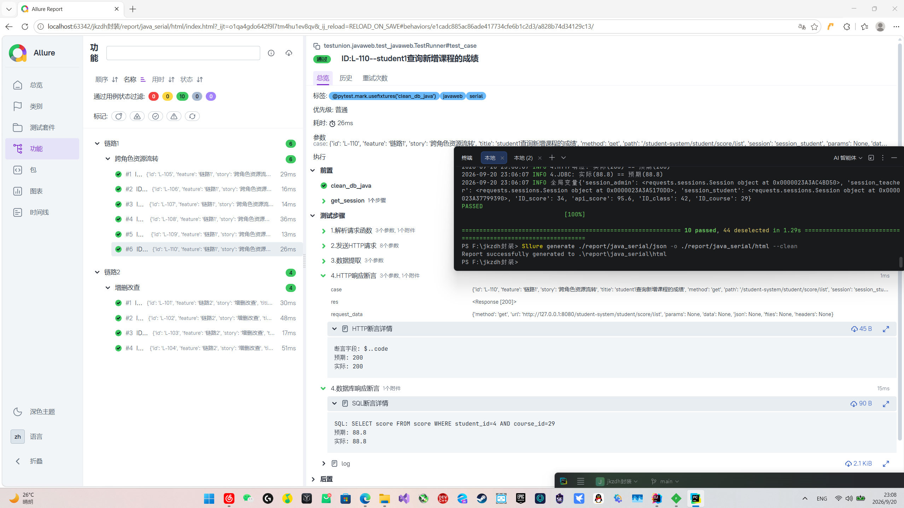
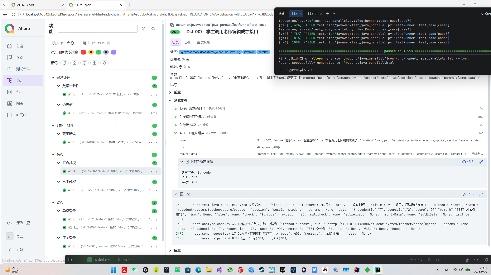

# 学生成绩管理系统（JavaWeb 课程作业 + 测试实战）
## 项目定位
本项目是《JavaWeb 应用》课程期末大作业，基于 Spring Boot + MyBatis + MySQL 开发，包含管理员、教师、学生三种角色。

**同时它作为自研接口自动化框架 [api-auto-test](https://gitee.com/S1lenceYYY/api-auto-test) 的被测靶系统**，完整落地接口测试全流程：
> **抓包分析 → 用例设计 → 框架适配 → 越权测试 → 缺陷排查 → 编写回归测试用例**

项目核心目标并非展示后端开发能力，而是：
1. 验证自研 Pytest 接口自动化框架在真实业务场景下的可用性；
2. 练习用例设计、接口测试、缺陷定位等测试基础能力；
3. 完整跑通从抓包分析到自动化回归的测试闭环。

---

## 技术栈
| 层级 | 技术 |
| :--- | :--- |
| **后端** | JDK 1.8, Spring Boot 2.7.18, Spring MVC, MyBatis, MySQL 8.0 |
| **前端** | HTML, CSS, jQuery, Bootstrap 4.6.2, JSP |
| **构建工具** | Maven |
| **测试工具** | Fiddler, Postman, Pytest |

---

## 测试全流程
### 1. 抓包分析（Fiddler）
- 抓取登录、班级、课程、成绩等核心接口
- 整理接口清单：URL、请求方法、入参、响应结构
- 识别接口鉴权方式（HttpSession）
- 使用断点篡改请求参数，验证后端异常处理逻辑

### 2. 用例设计（Excel）
| 类型 | 覆盖场景 |
| :--- | :--- |
| **正向用例** | 正常登录、业务增删改查 |
| **异常用例** | 空值、边界值、非法参数校验 |
| **越权用例** | 垂直越权、水平越权场景 |
| **双重断言** | 接口返回结果 + MySQL 数据库数据一致性校验 |

### 3. 框架适配（Pytest）
- **多角色会话管理**：admin / teacher / student 独立维护 Session
- **数据驱动**：Excel 存储测试用例，框架自动读取执行
- **双重断言**：同时校验 HTTP 响应与数据库存储数据
- **Allure 测试报告**：可视化展示测试执行结果
- **跨靶系统复用**：可与 Flask 靶项目共用同一套 api-auto-test 自动化框架

### 4. 越权测试
| 越权类型 | 场景 | 预期结果 |
| :--- | :--- | :--- |
| **垂直越权** | 学生调用管理员班级管理专属接口 | 返回 403，禁止访问 |
| **水平越权** | 教师 A 尝试修改教师 B 负责的学生成绩 | 返回 403，禁止访问 |
| **数据一致性校验** | 越权拦截后校验数据库，确认数据未被篡改 | 数据库无变更 |

### 5. 接口缺陷排查
- **垂直越权漏洞**：学生账号可调用管理员班级管理相关接口，拦截器仅校验登录状态，缺少角色校验。
- **异常堆栈泄露**：服务抛出 500 错误时，响应直接暴露表名、SQL 语句、Mapper 路径，标记为安全类缺陷。
- **业务校验缺失**：新增/修改时未做业务查重，依赖数据库唯一约束，触发 500 错误。
- **数据库字段缺失**：缺少 `semester` 列（已修复），导致教师查询接口报 500。


### 6. 编写回归测试用例
- 将已经复现的缺陷编写独立自动化回归用例
- 缺陷对应的回归用例存放于Excel测试文档，当缺陷修复时测试用例集验证是否修复


---

## 测试文档
完整测试文档见 [`doc/测试文档.xlsx`](doc/测试文档.xlsx)：

| Sheet | 内容 |
| :--- | :--- |
| **接口信息收集** | 核心接口的 URL、方法、参数、响应 |
| **缺陷跟踪** | 4 个缺陷的详细信息 |
| **回归用例** | 3 条回归用例——对应后端 Bug |
| **case1** | 独立用例——正向、异常、越权 |
| **case2** | 链路用例——成绩增删改查、跨角色资源流转 |

---

## 发现的缺陷
测试过程中共发现 **4 个缺陷**——3 个后端 + 1 个前端，其中1个已修复，其余保留作为靶场缺陷。

| 编号 | 缺陷描述                                     | 所属模块 | 严重程度 | 根因分析 |
| :--- |:-----------------------------------------| :--- | :--- | :--- |
| **BUG-001** | 垂直越权：学生账号可调用管理员班级管理相关接口                  | 权限管理 | 高 | `LoginInterceptor` 只校验登录状态，未校验访问接口对应的用户角色 |
| **BUG-002** | 数据库字段缺失：缺少 `semester` 列，教师查询接口报 500（已修复) | 课程管理 | 高 | 数据库建表脚本缺少字段，查询实体属性与表结构不一致 |
| **BUG-003** | 业务校验缺失：新增/修改数据未做业务查重                     | 全局 | 中 | Service层未增加业务唯一性校验，仅依赖数据库唯一约束，重复提交直接抛出500异常 |
| **FE-001** | 前端选课弹窗课程下拉框为空                            | 选课模块 | 中 | 前端接口返回数据渲染逻辑问题 |


---

## 项目结构
```text
student-management-system/
├── doc/
│   └── 测试文档.xlsx                       # 接口清单 + 缺陷跟踪 + 回归用例 + case1/case2
├── src/
│   └── main/
│       ├── java/
│       │   └── com/
│       │       └── student/
│       │           ├── common/             # 通用类（Result、SessionUtil 等）
│       │           ├── config/             # 配置类（WebConfig 拦截器注册）
│       │           ├── controller/         # 控制器层（Login、Admin、Teacher、Student）
│       │           ├── entity/             # 实体类（User、Class、Course、Score）
│       │           ├── interceptor/        # 拦截器（LoginInterceptor 鉴权）
│       │           ├── mapper/             # MyBatis Mapper 接口
│       │           ├── service/            # 业务逻辑层接口与实现
│       │           ├── util/               # 工具类
│       │           └── StudentManagementApplication.java  # Spring Boot 启动类
│       └── resources/
│           ├── db/                         # 数据库脚本
│           │   └── schema.sql              # 建表 SQL
│           ├── mapper/                     # MyBatis XML 映射文件
│           ├── static/                     # 静态资源（CSS/JS/图片）
│           ├── templates/                  # 前端页面模板（JSP/HTML）
│           ├── application.yml             # 本地配置文件（不上传 Gitee）
│           └── application.yml.example     # 配置模板文件（上传 Gitee）
├── .gitignore                              # Git 忽略规则
├── pom.xml                                 # Maven 依赖配置
└── README.md                               # 项目说明文档

``` 
##  快速开始

### 环境要求
- JDK 1.8+
- Maven 3.6+
- MySQL 8.0+

### 运行步骤
1. 导入 MySQL 数据库——执行 `src/main/resources/db/schema.sql`
2. 复制 `application.yml.example` 为 `application.yml`——填自己的数据库配置
3. Maven 编译——`mvn clean package`
4. 运行 `StudentManagementApplication`
5. 访问 `http://localhost:8080/student-system/login.html`

---
## 自动化测试报告展示
### 串行执行


---
### 并行执行

---

## 配套项目

- **接口自动化框架**：[api-auto-test](https://gitee.com/S1lenceYYY/api-auto-test)
- **框架能力**：数据驱动、多角色 Session、双重断言、Allure 报告、云端部署
